# Arduvaz

MyBB 1.8 için sade, modern ve mobil uyumlu bir tema. Arduvaz taşının gri-mavi tonlarından adını alır: açık zemin, koyu arduvaz vurgular, Inter yazı tipi ve kart tabanlı bir düzen.

Paket iki parçadan oluşur:

- **Forum teması** — ön yüzün tamamı (ana sayfa, forum ve konu sayfaları, profil, üye listesi, kullanıcı ve moderatör panelleri, özel mesajlar, arama ve diğerleri).
- **Admin CP stili** — yönetim paneli için aynı görünüm. Yalnızca CSS ile yapılmıştır; MyBB çekirdeğine dokunmaz.

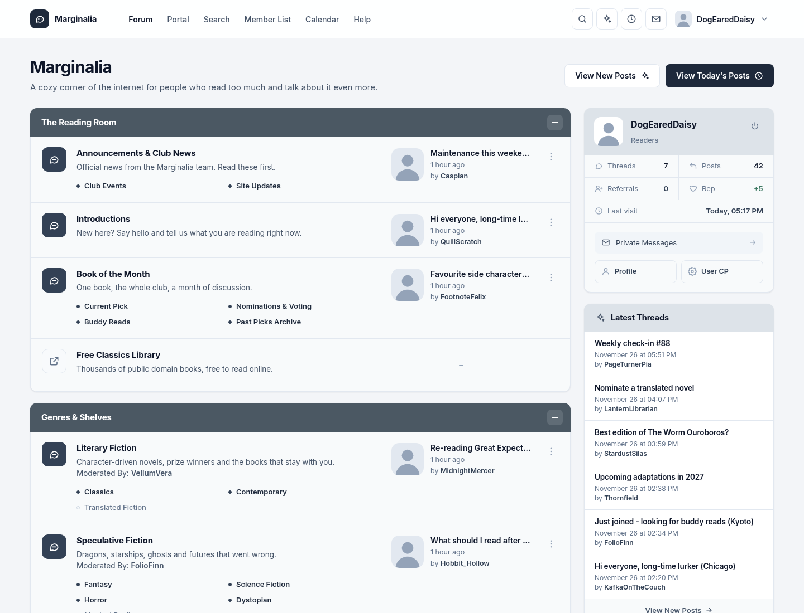

## Ekran görüntüleri

### Forum

| Forum | Konu |
|---|---|
| 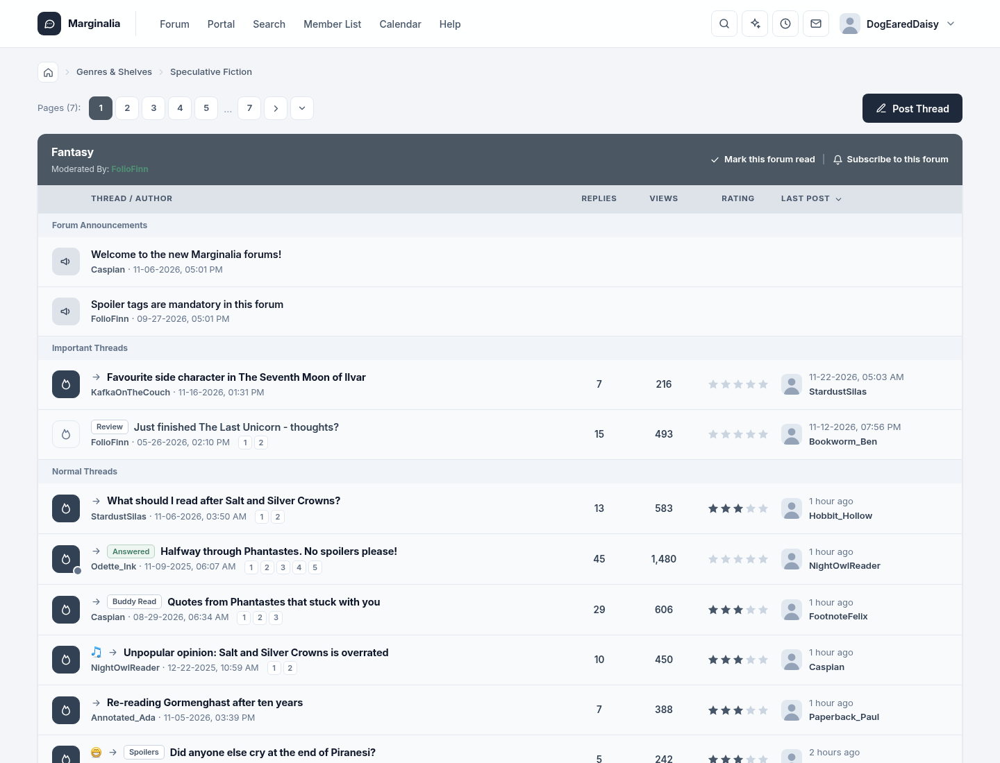 | 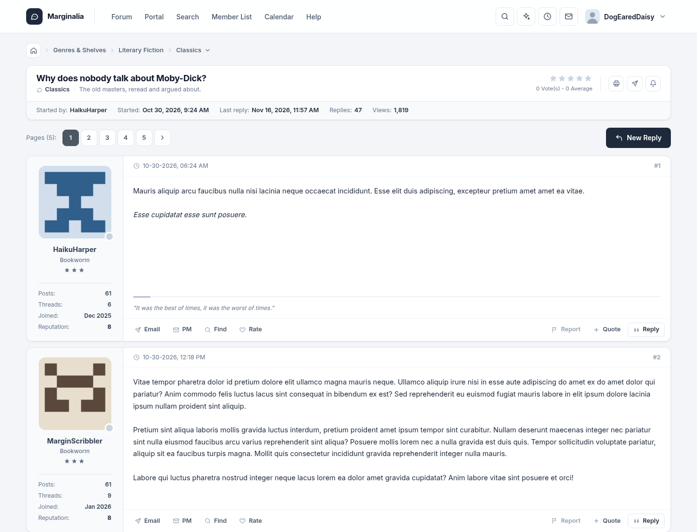 |

| Profil | Üye listesi |
|---|---|
| 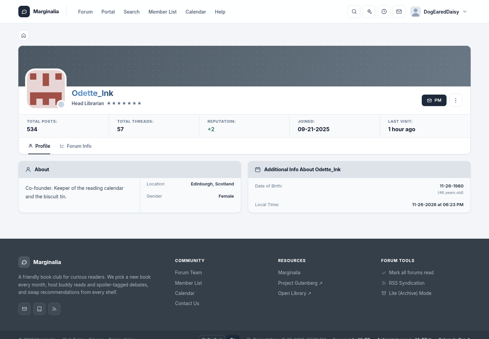 | 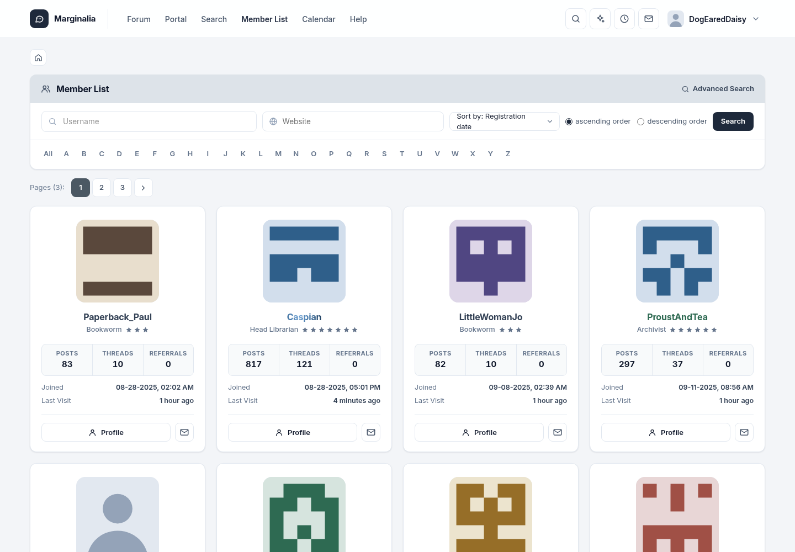 |

| Kullanıcı paneli |
|---|
| 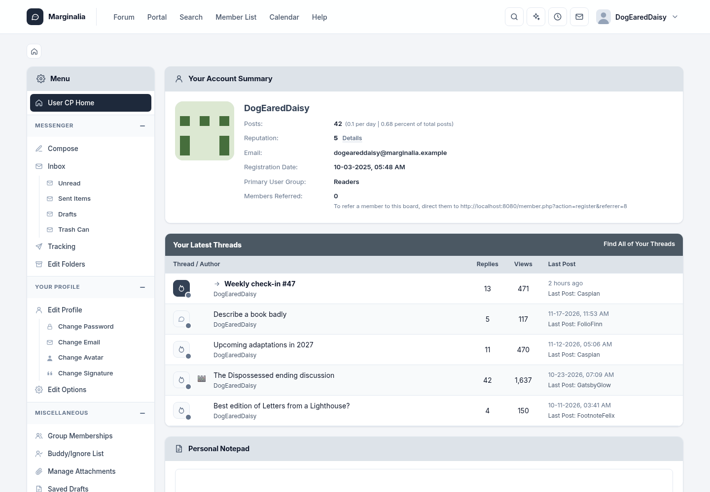 |

### Mobil

| Ana sayfa | Konu |
|---|---|
| 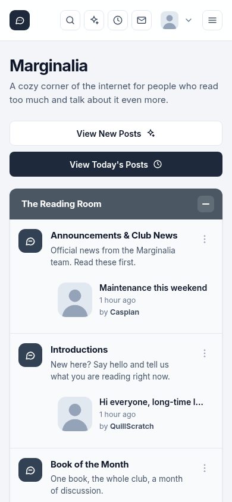 | 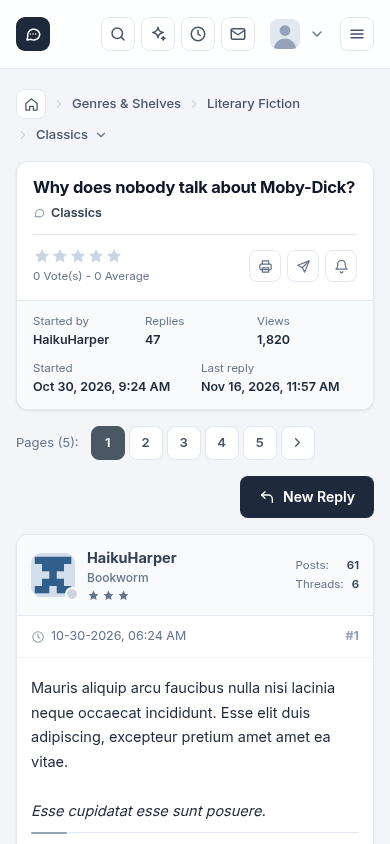 |

### Admin CP

| Ana sayfa | Ayarlar |
|---|---|
| 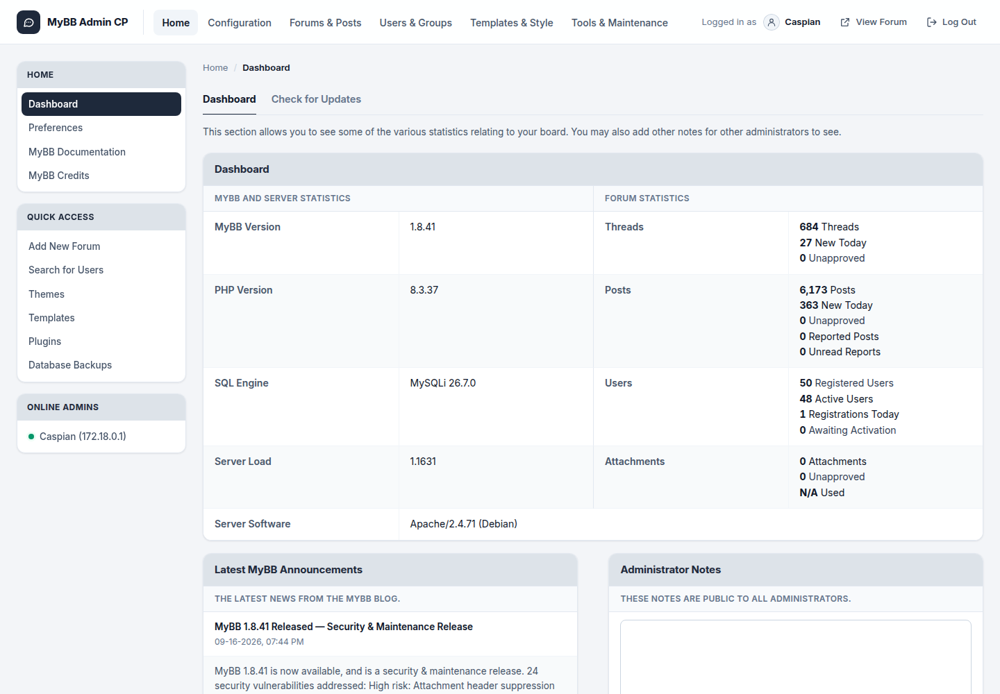 | 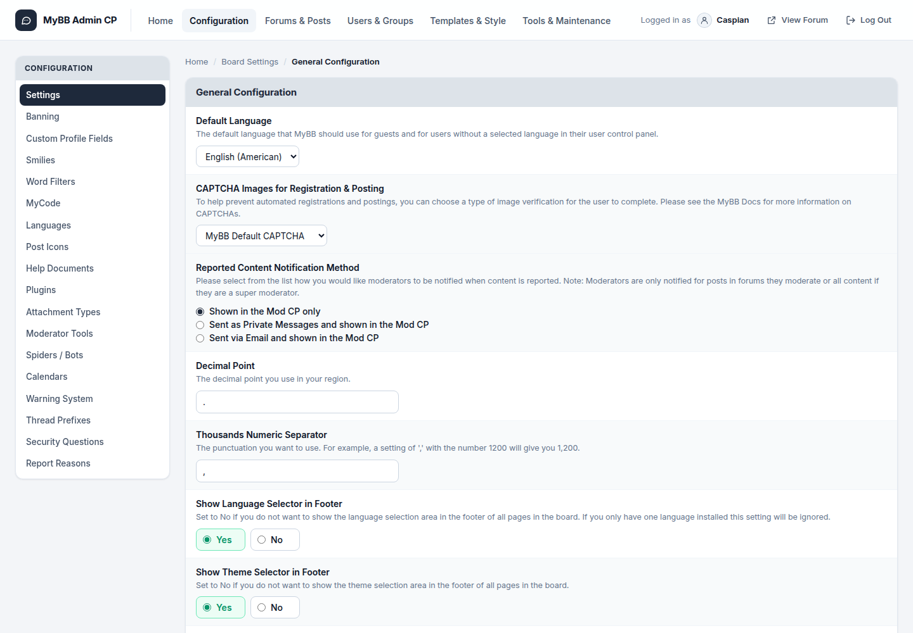 |

| Forum yönetimi | Giriş |
|---|---|
| 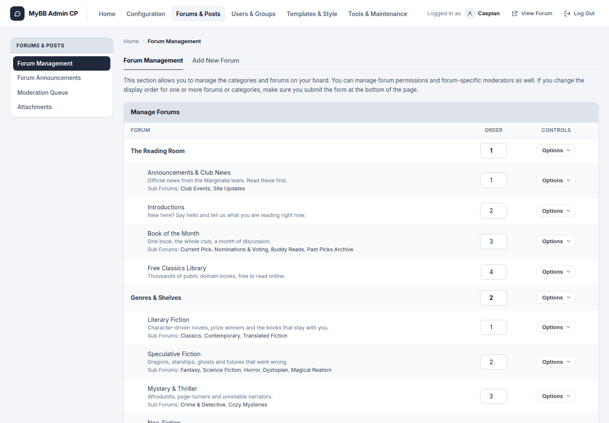 | 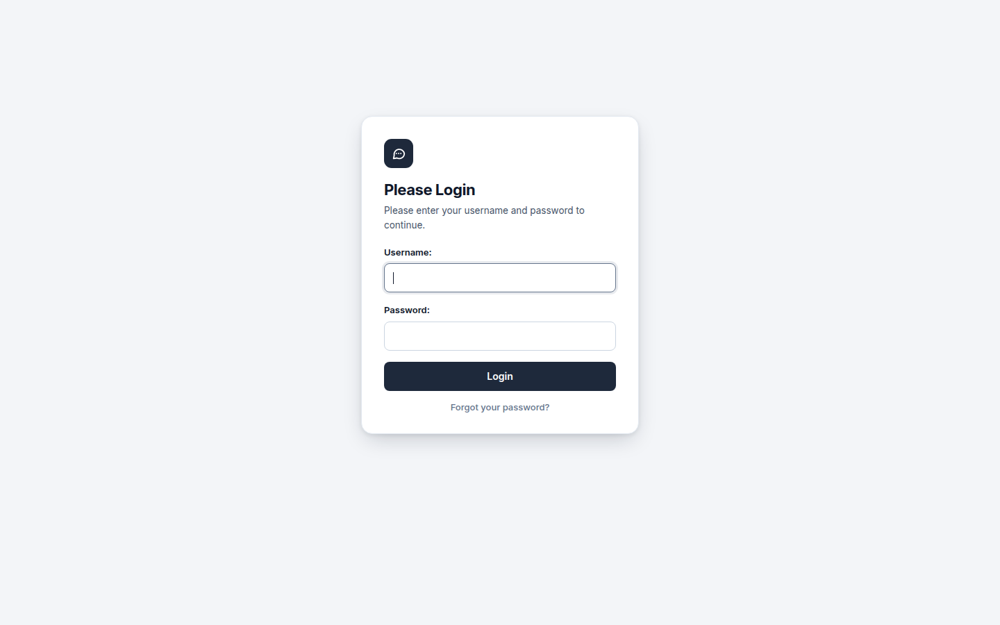 |

| Mobil |
|---|
| 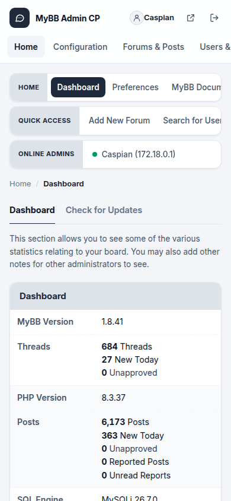 |

## Özellikler

- Duyarlı (responsive) tasarım: masaüstü, tablet ve telefon
- MyBB'nin çekirdek sınıf adları ve JavaScript'in kullandığı id/name değerleri korunur: hızlı yanıt, satır içi moderasyon ve diğer yerleşik özellikler çalışmaya devam eder
- Dil paketlerine saygılı: metinler `{$lang->…}` değişkenlerinden gelir
- Sayfaya özel stil dosyaları: her sayfa yalnızca ihtiyaç duyduğu CSS'i yükler
- SVG simge seti (`images/icons.svg`), harici simge kütüphanesi yok
- Admin CP: tablolar, formlar, sekmeler, açılır menüler, bildirimler, CodeMirror düzenleyici ve giriş ekranı

## Kurulum

Gereksinim: MyBB 1.8 (1.8.41 ile test edildi).

### Forum teması

1. `images/` klasörünün içeriğini forumunuzda `images/arduvaz/` klasörüne yükleyin.
2. `jscripts/arduvaz.js` dosyasını forumunuzun `jscripts/` klasörüne yükleyin.
3. Admin CP'de **Templates & Style → Themes → Import a Theme** sayfasından `dist/arduvaz-theme.xml` dosyasını içe aktarın.
4. Temayı varsayılan yapın ya da kullanıcıların seçimine açın.

### Admin CP stili

1. `admin/arduvaz/` klasörünü forumunuzda `admin/styles/arduvaz/` olarak yükleyin.
2. Kendi paneliniz için: **Home → Preferences** sayfasındaki *Admin Control Panel Theme* alanından `arduvaz` seçin.
3. Tüm yöneticiler ve giriş ekranı için: **Configuration → Settings → Control Panel Preferences (Global)** altındaki *Control Panel Style* ayarını `arduvaz` yapın. Giriş ekranı oturum açılmadan gösterildiği için bu genel ayarı kullanır.

`admin/arduvaz/style.php` yalnızca mobil uyum için sayfalara `viewport` meta etiketini ekler; çıktıda başka hiçbir değişiklik yapmaz.

## Kaynaktan derleme

Tema kaynağı düz dosyalar halindedir:

```
templates/   şablonlar (her şablon bir .html dosyası)
css/         stil dosyaları
theme.json   tema özellikleri ve stil dosyalarının bağlandığı sayfalar
images/      simgeler ve görseller
jscripts/    arduvaz.js
admin/       Admin CP stili
dist/        içe aktarılmaya hazır tema XML'i
```

`build.php`, bu dosyalardan `dist/arduvaz-theme.xml` dosyasını üretir ve temayı çalışan bir MyBB kurulumuna içe aktarır. MyBB'nin kök dizininde çalıştırılmak üzere yazılmıştır (yol `MYBB_ROOT` sabitindedir):

```sh
php build.php              # XML'i üret ve içe aktar
php build.php --no-import  # yalnızca XML'i üret
```

`deploy.sh`, geliştirme için kullanılan Docker ortamına özeldir: dosyaları yerel MyBB kopyasına aktarır ve `build.php`'yi `mybb` konteynerinde çalıştırır. Yerel kopya yolu `MYBB_SRC` değişkeniyle değiştirilebilir.

Geliştirme notları, statik bırakılan alanlar ve dil değişkeni henüz olmayan metinler [NOTES.md](NOTES.md) dosyasındadır.

## Telif

© 2026 [MyBB.tr](https://mybb.tr). Altbilgideki tema bağlantısı görünür kalmalıdır.
